# Kaffeine: High-Level Design (HLD)

> **What** the system is made of and **how the parts talk to each other**. Class-level details are in [LLD.md](LLD.md).
>
> Diagrams use **Mermaid**. They render on GitHub automatically. In VS Code, install the extension *"Markdown Preview Mermaid Support"* (`bierner.markdown-mermaid`) and open the preview (`Ctrl+Shift+V`).

---

## 1. System context

Kaffeine is a **library inside your application**. There is no separate server and no network.

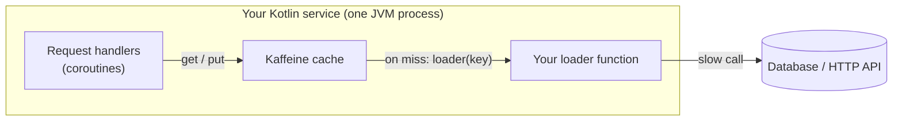

- **Hit:** the value is returned from memory in about 100 ns.
- **Miss:** the loader runs **once per key** (coalesced) and the result is stored.

---

## 2. Repository / module architecture

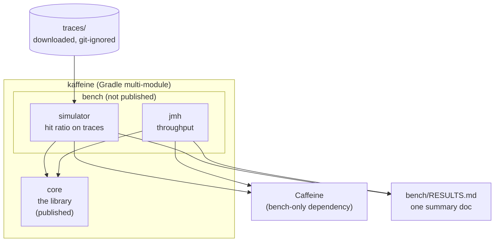

| Module | Purpose | Dependencies |
|--------|---------|--------------|
| `core` | The cache library | `kotlinx-coroutines-core` **only** |
| `bench` | Simulator (main) + JMH benchmarks (`src/jmh`) | `core`, Caffeine, JMH |

**Why two modules?** So the published library never drags Caffeine or JMH onto users' classpaths.

---

## 3. Components inside `core`

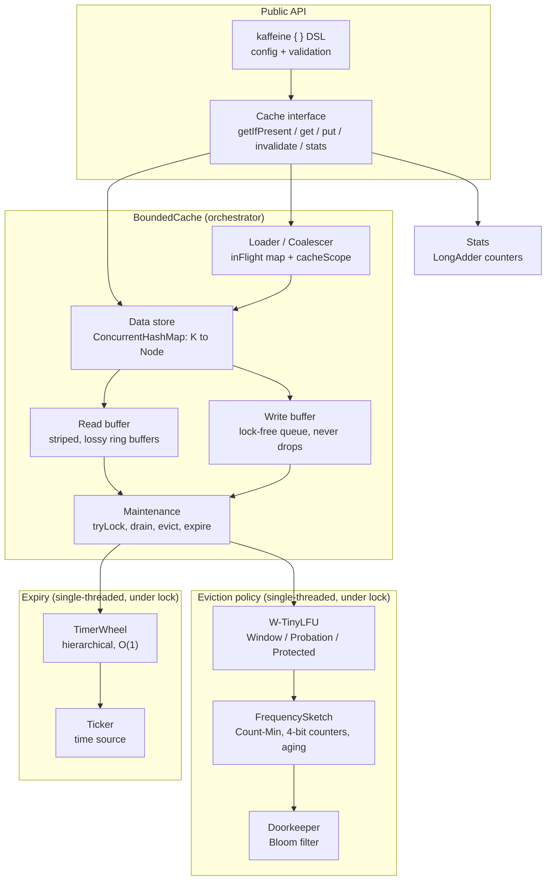

| Component | Responsibility | Thread safety |
|-----------|----------------|---------------|
| `ConcurrentHashMap` | Holds the actual data. Source of truth for "is the key cached?" | Thread-safe (lock-free reads) |
| Read buffer | Records "node X was read" for the policy | Lock-free, **lossy** (dropping is OK) |
| Write buffer | Records "node X was added / updated / removed" | Lock-free, **never drops** |
| Maintenance | Applies the buffered events to the policy and the wheel, evicts, expires | One thread at a time (`tryLock`) |
| W-TinyLFU policy | Decides **who is evicted** | Not thread-safe; only touched under the lock |
| FrequencySketch + Doorkeeper | Estimates key popularity | Not thread-safe; only under the lock |
| TimerWheel | Finds expired entries in O(1) | Not thread-safe; only under the lock |
| Coalescer | One in-flight load per key | `ConcurrentHashMap.computeIfAbsent` + `CompletableDeferred` |
| Stats | Counters | `LongAdder` (contention-free) |

### The core idea: separate the *data* from the *policy*

- The **data** (the map) must be correct and fast **right now**, for every thread.
- The **policy** (who to evict) can be **a few operations behind** without hurting correctness. So threads leave notes in buffers, and one thread at a time applies them.

This is what makes reads fast: **a read never takes a lock**.

---

## 4. Key design decisions

| # | Decision | Alternatives considered | Why this one |
|---|----------|-------------------------|--------------|
| D1 | `ConcurrentHashMap` stores the data | A custom hash table | Battle-tested, lock-free reads, atomic `compute*` |
| D2 | The policy is updated **through buffers**, under `tryLock` | Lock on every operation (v1) | Reads never block. Built as v1 → v2 so the speedup can be **measured** |
| D3 | **W-TinyLFU** eviction | LRU, LFU, ARC | Best hit ratio across mixed workloads, with small memory |
| D4 | **Count-Min Sketch with 4-bit counters** + periodic halving | An exact counter map | About 8 bytes per entry. Aging handles changing popularity |
| D5 | **Doorkeeper Bloom filter** is optional (a flag) | Always on / never | Comes from the TinyLFU paper. The **simulator decides** the default with data |
| D6 | **One timing wheel for all expiry modes** | Order queues for fixed TTL plus a wheel for variable TTL (Caffeine) | One mechanism, less code, still O(1) |
| D7 | Expired entries are **checked on read** as well as cleaned by the wheel | Wheel only | The wheel is coarse (~1 s). The read check guarantees an expired value is never returned |
| D8 | Coalescing with **`CompletableDeferred` in an `inFlight` map**; the load runs in a **cache-owned `SupervisorJob` scope** | Run the load in the caller's coroutine | One caller cancelling must not kill the load for the others |
| D9 | Maintenance runs **on the calling thread** (amortized) | A background executor (Caffeine uses ForkJoinPool) | Deterministic and simpler. No thread pool to manage |
| D10 | Injectable **`Ticker`** | `System.nanoTime()` directly | Expiry tests run instantly and deterministically |
| D11 | **Simulator first** | Build the concurrent cache first | The policy is checked on real traces before concurrency adds noise |
| D12 | No dependencies besides coroutines | Use helper libraries | Keeps the library small, and shows we can build the pieces ourselves |

---

## 5. Main flows

### 5.1 Read hit: `getIfPresent(key)`

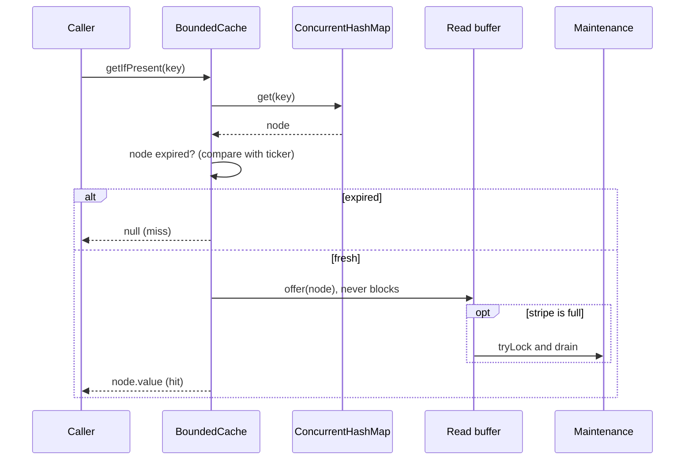

**No lock is taken on the read path.** If the read buffer is full, the note is simply dropped.

### 5.2 Write: `put(key, value)`

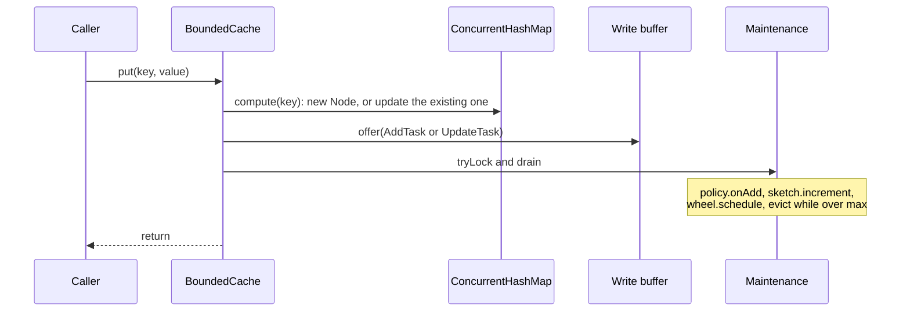

### 5.3 Load with coalescing: `suspend get(key, loader)`

Two callers ask for the same missing key at the same time:

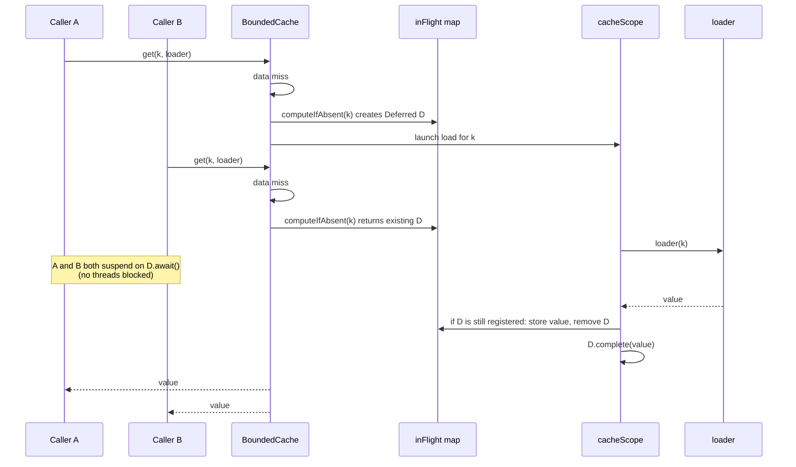

### 5.4 W-TinyLFU: what happens when a node is added

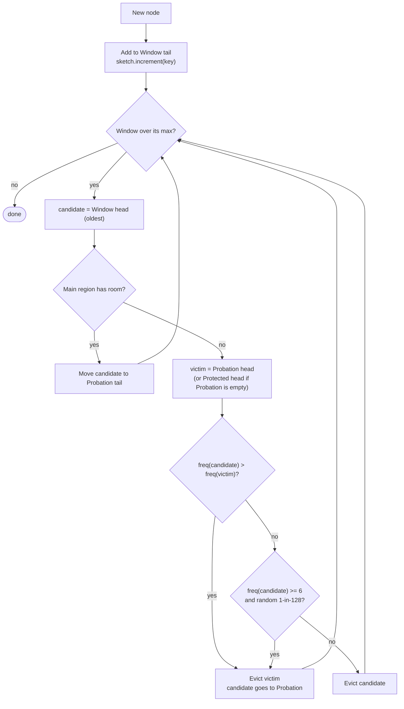

On a **hit** (applied during maintenance):

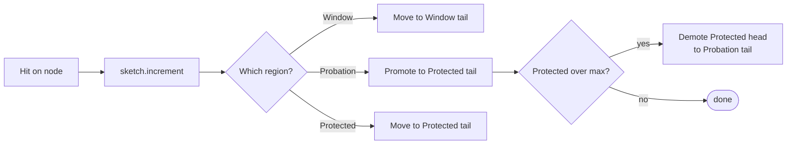

### 5.5 Maintenance cycle

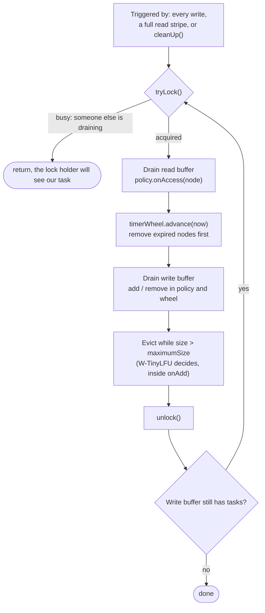

The final re-check prevents a **lost wakeup**. Without it, a task added just as the drainer was unlocking would sit in the queue forever.

### 5.6 Expiry

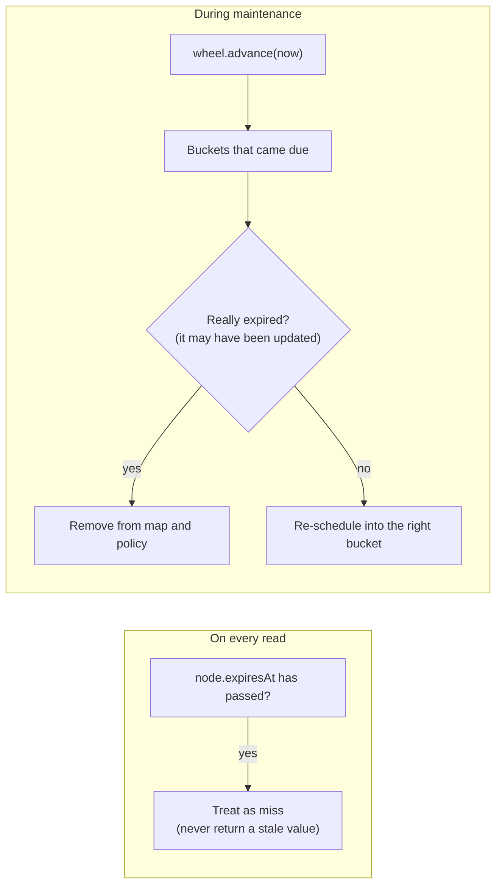

---

## 6. Concurrency model

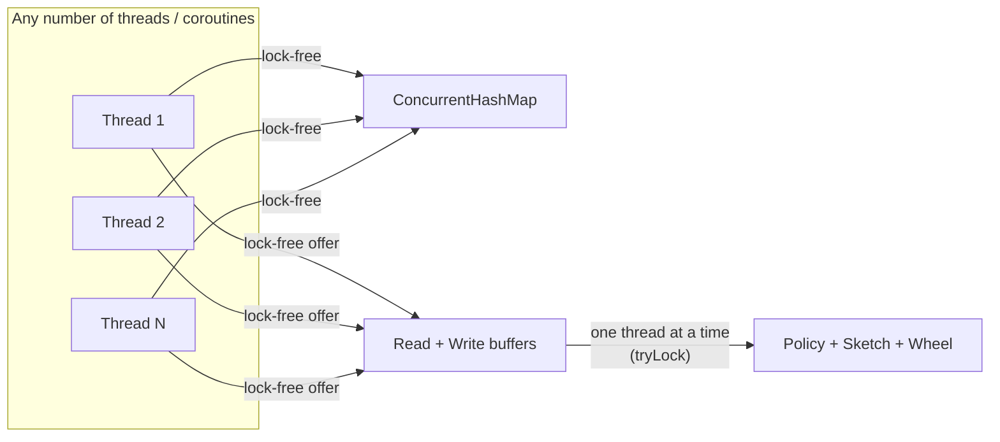

| Rule | Reason |
|------|--------|
| The map is the **source of truth** | The policy may be behind. The map never is |
| Policy, sketch and wheel are touched **only under the maintenance lock** | They are plain (non-thread-safe) structures, which keeps them fast and simple |
| Every node has a **lifecycle state** (Alive → Retired → Dead) | Buffered events can arrive out of order (e.g. "remove" before "add") |
| No slow work inside `ConcurrentHashMap.compute*` | It holds a bin lock and would block unrelated keys |
| The loader never runs while holding a lock | Loaders are slow and may suspend |

---

## 7. Error handling and cancellation semantics

| Situation | Behavior |
|-----------|----------|
| Loader throws | All waiters get the exception. **Nothing is cached**. The next `get` retries |
| One waiter is cancelled | Only that waiter stops. The load continues for the others |
| **All** waiters are cancelled | The load still completes and the value is cached (useful work isn't thrown away) |
| `invalidate(k)` during an in-flight load | The load finishes, but its value is **not stored** |
| `put(k, v)` during an in-flight load | `v` wins. The load finishes, the waiters get its value, but it does not overwrite `v` |
| Loader calls `get` for the **same key** (recursion) | Not supported. It would wait on itself (documented, like Caffeine) |
| Invalid config (e.g. `maximumSize <= 0`, two expiry modes) | `IllegalArgumentException` at build time |

---

## 8. Benchmark architecture

### 8.1 Hit-ratio simulator

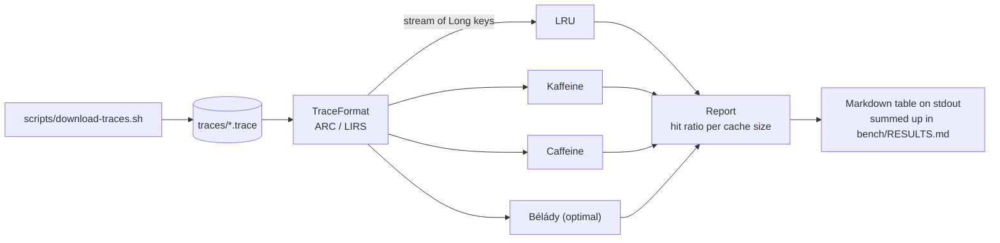

Single-threaded, so the results are **deterministic**.

### 8.2 Throughput (JMH)

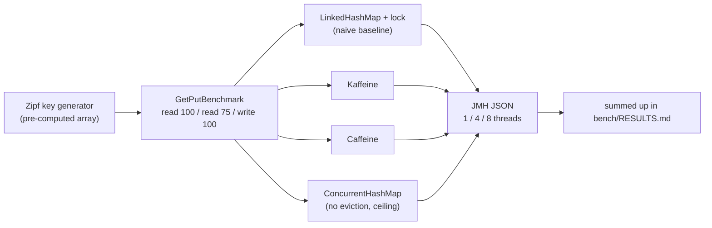

---

## 9. Build, CI and release

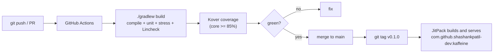

- JMH and the full simulator run **locally** (too noisy and too slow for CI). Their results are committed.
- CI runs the simulator only on a **tiny synthetic trace** (smoke test).

---

## 10. Testing strategy (overview)

| Layer | What | Tool |
|-------|------|------|
| Unit | Sketch, Bloom filter, deque, policy, wheel, read buffer | JUnit 5 |
| Cache semantics | put/get/invalidate, size bound, expiry with fake time | JUnit 5 + `FakeTicker` |
| Coroutines | Coalescing, failure, cancellation, invalidate during load | `kotlinx-coroutines-test` |
| Concurrency | Linearizability of the map operations | **Lincheck** (JetBrains) |
| Stress | N threads doing random operations, then check invariants | JUnit 5 + threads |
| Simulator | Hand-made tiny traces with known hit counts | JUnit 5 |
| Coverage | ≥ 85% of `core` | Kover |

Details per class are in [LLD.md §10](LLD.md#10-test-plan).
