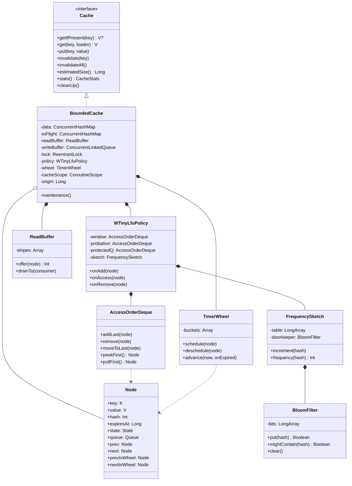
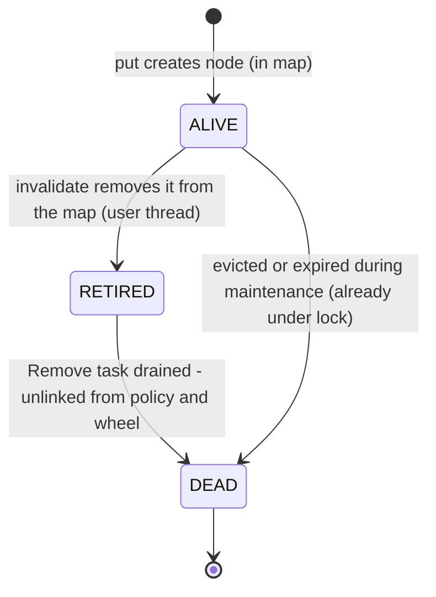
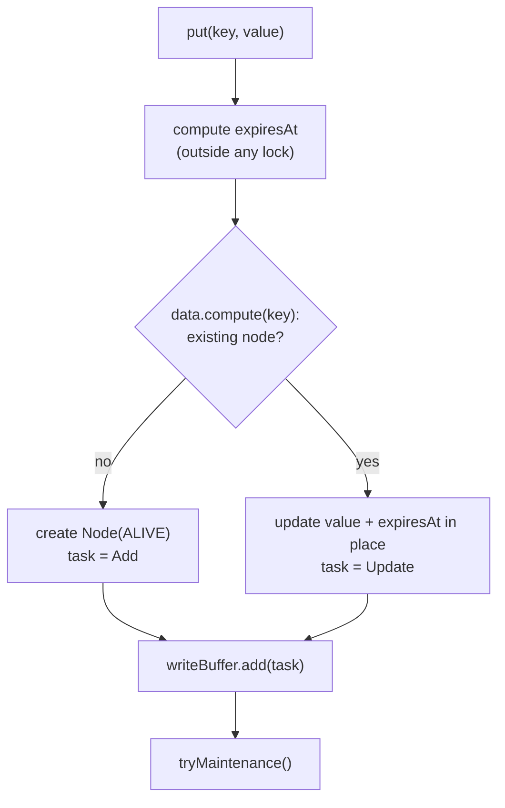
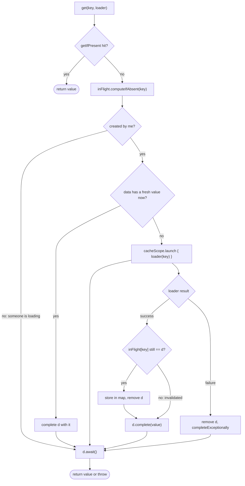

# Kaffeine: Low-Level Design (LLD)

> Class-level design: files, fields, algorithms, races and tests. Read [HLD.md](HLD.md) first.
> Mermaid diagrams: GitHub renders them. In VS Code, use the *Markdown Preview Mermaid Support* extension.

---

## 1. Folder structure

```
kaffeine/
├── .github/workflows/ci.yml          # build + test + coverage on every push / PR
├── .gitignore                        # ignores docs/learn/, build/, traces/, IDE files
├── README.md
├── jitpack.yml                       # tells JitPack to build with JDK 17
├── settings.gradle.kts               # include("core", "bench")
├── build.gradle.kts                  # shared config (Kotlin, JVM 17)
├── gradle.properties
├── gradle/
│   ├── libs.versions.toml            # every dependency version in one place
│   └── wrapper/                      # Gradle wrapper (committed)
├── gradlew, gradlew.bat
├── scripts/
│   └── download-traces.sh            # fetches public traces into traces/
├── docs/
│   ├── PRD.md  HLD.md  LLD.md  PLAN.md
│   └── learn/                        # local learning notes (git-ignored)
├── core/                             # ── THE LIBRARY (published) ──
│   ├── build.gradle.kts
│   └── src/
│       ├── main/kotlin/io/github/shashankpatildev/kaffeine/
│       │   ├── Cache.kt                  # public interface
│       │   ├── Kaffeine.kt               # kaffeine { } DSL, KaffeineConfig, validation
│       │   ├── CacheStats.kt             # public stats snapshot
│       │   ├── Ticker.kt                 # time source
│       │   └── internal/
│       │       ├── BoundedCache.kt       # orchestrator: map, buffers, maintenance, loading, stats
│       │       ├── Node.kt               # entry + lifecycle state + list links
│       │       ├── Bits.kt               # spread() hash mixer + power-of-two helper
│       │       ├── AccessOrderDeque.kt   # intrusive O(1) doubly linked list
│       │       ├── FrequencySketch.kt    # Count-Min Sketch (+ optional doorkeeper)
│       │       ├── BloomFilter.kt        # the doorkeeper
│       │       ├── WTinyLfuPolicy.kt     # window / probation / protected + admission
│       │       ├── TimerWheel.kt         # hierarchical timing wheel
│       │       └── ReadBuffer.kt         # striped, lossy ring buffers
│       └── test/kotlin/io/github/shashankpatildev/kaffeine/
│           ├── FakeTicker.kt
│           ├── CacheTest.kt              # API semantics, size bound
│           ├── ExpiryTest.kt
│           ├── LoadingTest.kt            # coroutines: coalescing, failure, cancellation
│           ├── StressTest.kt             # many threads, random ops, invariants
│           ├── LincheckTest.kt           # linearizability
│           └── internal/                 # one test file per internal class
│               ├── AccessOrderDequeTest.kt
│               ├── FrequencySketchTest.kt
│               ├── BloomFilterTest.kt
│               ├── WTinyLfuPolicyTest.kt
│               ├── TimerWheelTest.kt
│               └── ReadBufferTest.kt
├── bench/                            # ── SIMULATOR + JMH (not published) ──
│   ├── build.gradle.kts
│   ├── src/main/kotlin/io/github/shashankpatildev/kaffeine/bench/
│   │   ├── Simulator.kt                  # CLI: replay traces, print report
│   │   ├── Traces.kt                     # LIRS / ARC readers
│   │   ├── SimPolicies.kt                # LRU, Kaffeine, Caffeine
│   │   ├── Belady.kt                     # optimal policy + small primitive helpers
│   │   └── Report.kt                     # Markdown table + CSV
│   ├── src/test/kotlin/.../bench/SimulatorTest.kt   # tiny traces with known answers
│   ├── src/jmh/kotlin/.../bench/
│   │   ├── GetPutBenchmark.kt
│   │   ├── BenchCaches.kt                # adapters: Kaffeine, Caffeine, LinkedHashMap+lock, CHM
│   │   └── Zipf.kt                       # Zipf key generator
│   └── results/
│       ├── hit-ratio/                    # committed CSV + Markdown
│       └── jmh/                          # committed JSON
└── traces/                           # downloaded traces (git-ignored)
```

**Package:** `io.github.shashankpatildev.kaffeine` (package names can't contain `-`, so `shashankpatil-dev` becomes `shashankpatildev`).

**Visibility:** only `Cache`, `kaffeine {}`, `KaffeineConfig`, `CacheStats` and `Ticker` are public. Everything in `internal/` uses Kotlin's `internal` modifier (visible inside `core` only, including its tests). `core` turns on **`explicitApi()`**, so the compiler forces every public declaration to be marked deliberately.

---

## 2. Build setup

| File | Key contents |
|------|--------------|
| `settings.gradle.kts` | `include("core", "bench")` |
| `gradle/libs.versions.toml` | Kotlin 2.x, kotlinx-coroutines, JUnit 5, kotlinx-coroutines-test, Lincheck, Caffeine, JMH plugin (`me.champeau.jmh`), Kover. **Exact latest stable versions get pinned in Step 1** |
| `core/build.gradle.kts` | `kotlin("jvm")`, `maven-publish`, Kover. `jvmToolchain(17)`, `explicitApi()`. Dependencies: `api(coroutines)`, test: JUnit, coroutines-test, Lincheck |
| `bench/build.gradle.kts` | `kotlin("jvm")`, `application` (simulator main), `me.champeau.jmh`. Dependencies: `project(":core")`, Caffeine |

| Command | What it does |
|---------|--------------|
| `./gradlew build` | Compile everything and run all tests (what CI runs) |
| `./gradlew :core:test` | Library tests only |
| `./gradlew :core:koverHtmlReport` | Coverage report |
| `./gradlew :bench:run --args="--trace traces/DS1.lis --format arc --sizes 1000,10000"` | Hit-ratio simulation |
| `./gradlew :bench:jmh` | Throughput benchmarks → `bench/results/jmh/` |

---

## 3. Public API

```kotlin
public interface Cache<K : Any, V : Any> {
    public fun getIfPresent(key: K): V?                          // null if absent or expired
    public suspend fun get(key: K, loader: suspend (K) -> V): V  // coalesced loading
    public fun put(key: K, value: V)
    public fun invalidate(key: K)
    public fun invalidateAll()
    public fun estimatedSize(): Long
    public fun stats(): CacheStats
    public fun cleanUp()                                         // run maintenance now
}

public class KaffeineConfig<K : Any, V : Any> internal constructor() {
    public var maximumSize: Long = -1                            // required, > 0
    public var expireAfterWrite: Duration? = null
    public var expireAfterAccess: Duration? = null
    public var expireAfter: ((K, V) -> Duration)? = null         // per-entry TTL on create/update
    public var recordStats: Boolean = false
    public var ticker: Ticker = Ticker.SYSTEM
    public var loadContext: CoroutineContext = Dispatchers.Default
    public var doorkeeper: Boolean = true                        // default decided in Step 1 by the simulator
}

public fun <K : Any, V : Any> kaffeine(configure: KaffeineConfig<K, V>.() -> Unit): Cache<K, V>

public fun interface Ticker {
    public fun read(): Long                                      // nanoseconds, monotonic
    public companion object { public val SYSTEM: Ticker = Ticker { System.nanoTime() } }
}

public data class CacheStats(
    val hitCount: Long, val missCount: Long,
    val loadSuccessCount: Long, val loadFailureCount: Long,
    val totalLoadTimeNanos: Long, val evictionCount: Long,
) {
    val requestCount: Long get() = hitCount + missCount
    val hitRate: Double get() = if (requestCount == 0L) 1.0 else hitCount.toDouble() / requestCount
}
```

**Validation in `kaffeine {}`** (throws `IllegalArgumentException`):
- `maximumSize > 0`
- at most **one** of `expireAfterWrite`, `expireAfterAccess`, `expireAfter`
- fixed TTLs must be positive
- `loadContext[Job] == null`. A `Job` in the context would replace our `SupervisorJob` and break the cancellation rules (§7.8).

---

## 4. Class diagram



---

## 5. Node

```kotlin
internal class Node<K : Any, V : Any>(
    val key: K,
    @Volatile var value: V,
    val hash: Int,                       // spread(key.hashCode()), computed once
    @Volatile var expiresAt: Long,       // relative nanos (§7.10); NEVER = Long.MAX_VALUE
) {
    @Volatile var state = State.ALIVE

    // ---- touched ONLY under the maintenance lock ----
    var queue = Queue.NONE               // which policy list the node is in
    var prev: Node<K, V>? = null         // access-order deque links
    var next: Node<K, V>? = null
    var prevInWheel: Node<K, V>? = null  // timer wheel bucket links
    var nextInWheel: Node<K, V>? = null
    var wheelLevel = -1                  // -1 = not scheduled
    var wheelIndex = -1

    fun isExpired(now: Long) = now >= expiresAt

    enum class State { ALIVE, RETIRED, DEAD }
    enum class Queue { NONE, WINDOW, PROBATION, PROTECTED }
}
```

### Node lifecycle



| State | In map? | In policy / wheel? | Who sets it |
|-------|---------|--------------------|-------------|
| ALIVE | yes | yes, or about to be (Add task pending) | constructor |
| RETIRED | no | maybe (Remove task pending) | `invalidate` (any thread) |
| DEAD | no | no | maintenance (under lock) |

**Memory per entry** (compressed oops, estimate): Node ~64 B + ConcurrentHashMap node ~32 B + sketch ~8 B ≈ **~100 B** on top of the key and value. Measured in Step 4 if time allows.

---

## 6. Hashing

```kotlin
internal fun spread(x: Int): Int {            // fixes weak hashCodes (e.g. Int.hashCode() == the number)
    var h = ((x ushr 16) xor x) * 0x45d9f3b
    h = ((h ushr 16) xor h) * 0x45d9f3b
    return (h ushr 16) xor h
}
```

---

## 7. Components

### 7.1 AccessOrderDeque: intrusive doubly linked list

"Intrusive" means the `prev`/`next` links live **inside the Node**. There's no wrapper object per element, and removing a node you already hold is O(1).

```
head ⇄ [n1] ⇄ [n2] ⇄ [n3] ⇄ tail
oldest (evict / candidate)    newest (just used)
```

| Method | Cost | Note |
|--------|------|------|
| `addLast(n)` | O(1) | link at the tail |
| `remove(n)` | O(1) | relink `n.prev` ⇄ `n.next`, then null out n's links |
| `moveToLast(n)` | O(1) | remove + addLast |
| `peekFirst()` / `pollFirst()` | O(1) | the oldest node |
| `size` | O(1) | counter |

A node is in **at most one** deque at a time (window, probation or protected), so one pair of links is enough.

### 7.2 FrequencySketch: Count-Min Sketch with 4-bit counters

**Layout:** `table = LongArray(ceilPow2(maximumSize))`. Each Long holds **16 counters × 4 bits**. Each key touches **4 counters** (depth 4), one in each of 4 different Longs, chosen by 4 seeded hashes.

```kotlin
private val SEED = longArrayOf(            // well-known mixing constants
    -0x3c5a37a36834ced9L, -0x4b6d499041670d8dL, -0x651e95c4d06fbfb1L, -0x340d631b7bdddcdbL)
private const val RESET_MASK = 0x7777_7777_7777_7777L   // clears each nibble's top bit after >>> 1
private const val ONE_MASK   = 0x1111_1111_1111_1111L   // the low bit of each nibble

private fun indexOf(hash: Int, i: Int): Int {          // which Long for row i
    var h = (hash + SEED[i]) * SEED[i]
    h += h ushr 32
    return h.toInt() and tableMask
}

fun increment(hash: Int) {
    if (doorkeeper != null && doorkeeper.put(hash)) return   // first sighting: only remember it
    val start = (hash and 3) shl 2                           // which group of 4 counters (0, 4, 8, 12)
    var added = false
    for (i in 0 until 4) {
        val index = indexOf(hash, i)
        val offset = (start + i) shl 2                       // bit position of the nibble: 0..60
        val mask = 0xFL shl offset
        if (table[index] and mask != mask) {                 // not saturated at 15
            table[index] += 1L shl offset
            added = true
        }
    }
    if (added && ++size >= sampleSize) reset()               // sampleSize = 10 × maximumSize
}

fun frequency(hash: Int): Int {
    val start = (hash and 3) shl 2
    var f = 15
    for (i in 0 until 4) {
        val offset = (start + i) shl 2
        f = minOf(f, ((table[indexOf(hash, i)] ushr offset) and 0xF).toInt())
    }
    return f + if (doorkeeper?.mightContain(hash) == true) 1 else 0
}

private fun reset() {                                        // AGING: halve every counter
    var odd = 0
    for (i in table.indices) {
        odd += java.lang.Long.bitCount(table[i] and ONE_MASK)   // odd counters lose 0.5 when halved
        table[i] = (table[i] ushr 1) and RESET_MASK
    }
    size = (size - (odd ushr 2)) ushr 1                      // /4 because each increment touched 4 counters
    doorkeeper?.clear()
}
```

> This is a CMS variant where all rows **share one table**. Each "row" is just a different hash, which works the same and keeps memory compact. It's the design Caffeine used for years.

### 7.3 BloomFilter: the doorkeeper

| Parameter | Value |
|-----------|-------|
| Bits `m` | `ceilPow2(sampleSize × 8)`: about 8 bits per key between resets (~3% false positives) |
| Hashes `k` | 4, derived with **double hashing**: `pos_i = (h1 + i × h2) and (m - 1)` |
| `put(hash)` | Sets the 4 bits. **Returns `true` if any bit was 0** (= first sighting) |
| `mightContain(hash)` | All 4 bits set? |
| `clear()` | `bits.fill(0)`, called on every sketch reset |

The doorkeeper's memory cost (~10 B per entry) vs its hit-ratio gain is **measured in Step 1**. That result decides the default of `doorkeeper`.

### 7.4 WTinyLfuPolicy

**Sizes** (counts, not weights):

```
windowMax    = max(1, maximumSize / 100)         // 1%
mainMax      = maximumSize - windowMax           // 99%
protectedMax = mainMax * 80 / 100                // 80% of main, probation gets the rest
```

```
              ┌──────────── maximumSize ────────────────────────────┐
              │ Window 1% │  Probation ~20% of main │ Protected ~80% │
              │   (LRU)   │        (LRU)            │     (LRU)      │
              └───────────┴─────────────────────────┴────────────────┘
 new → tail of Window      hit in probation → promoted to protected
                           protected overflow → demoted to probation tail
```

```kotlin
internal class WTinyLfuPolicy<K : Any, V : Any>(
    maximumSize: Long,
    private val sketch: FrequencySketch,
    private val evict: (Node<K, V>) -> Unit,          // BoundedCache removes it from the map
    private val random: Random = Random.Default,      // tests pass a seeded Random
) {
    fun onAdd(node: Node<K, V>) {
        sketch.increment(node.hash)
        node.queue = WINDOW; window.addLast(node)
        evictIfNeeded()
    }

    fun onAccess(node: Node<K, V>) {
        sketch.increment(node.hash)
        when (node.queue) {
            WINDOW    -> window.moveToLast(node)
            PROBATION -> {                                       // second chance → protected
                probation.remove(node); node.queue = PROTECTED; protectedQ.addLast(node)
                if (protectedQ.size > protectedMax) {
                    val demoted = protectedQ.pollFirst()!!
                    demoted.queue = PROBATION; probation.addLast(demoted)
                }
            }
            PROTECTED -> protectedQ.moveToLast(node)
            NONE      -> Unit                                    // not in policy (dead or not yet added)
        }
    }

    fun onRemove(node: Node<K, V>) { dequeOf(node.queue)?.remove(node); node.queue = NONE }

    private fun evictIfNeeded() {
        while (window.size > windowMax) {
            val candidate = window.pollFirst()!!
            if (probation.size + protectedQ.size < mainMax) {     // main has room: admit for free
                candidate.queue = PROBATION; probation.addLast(candidate); continue
            }
            val victim = probation.peekFirst() ?: protectedQ.peekFirst()
            if (victim != null && admit(candidate.hash, victim.hash)) {
                onRemove(victim); evict(victim)
                candidate.queue = PROBATION; probation.addLast(candidate)
            } else {
                candidate.queue = NONE; evict(candidate)
            }
        }
    }

    private fun admit(candidateHash: Int, victimHash: Int): Boolean {
        val c = sketch.frequency(candidateHash)
        val v = sketch.frequency(victimHash)
        if (c > v) return true
        // HashDoS guard: an attacker can keep the victim's count high to block all newcomers.
        // A warm candidate gets a small random chance.
        return c >= 6 && random.nextInt(128) == 0
    }
}
```

Edge case `maximumSize = 1`: windowMax = 1 and mainMax = 0, so the victim is always `null` and the candidate is evicted. The cache holds 1 entry in the window ✓.

### 7.5 TimerWheel

**Layout** (time is **relative nanos ≥ 0**, see §7.10):

| Level | Buckets | Bucket span | Covers | Shift |
|-------|---------|-------------|--------|-------|
| 0 | 64 | 2^30 ns ≈ 1.07 s | ~1.1 min | 30 |
| 1 | 64 | 2^36 ns ≈ 1.14 min | ~1.2 h | 36 |
| 2 | 32 | 2^42 ns ≈ 1.22 h | up to 2^46 ns ≈ 19.5 h | 42 |
| 3 | 4 | 2^46 ns ≈ 19.5 h | ~3.3 days | 46 |
| 4 | 1 | overflow | everything beyond | 48 |

Each bucket is a doubly linked list through `prevInWheel`/`nextInWheel`. `buckets[level][index]` holds the head. The node remembers `wheelLevel`/`wheelIndex`, so unlinking a head is O(1) too.

```kotlin
fun schedule(node: Node<K, V>) {
    val delay = maxOf(0L, node.expiresAt - nanos)            // nanos = time of the last advance
    for (level in 0 until 4) {
        if (delay < (1L shl SHIFT[level + 1])) {             // fits in this wheel
            val index = ((node.expiresAt ushr SHIFT[level]) and (BUCKETS[level] - 1L)).toInt()
            link(node, level, index); return
        }
    }
    link(node, 4, 0)                                          // overflow bucket
}

fun advance(now: Long, onExpired: (Node<K, V>) -> Unit) {
    val previous = nanos; nanos = now
    for (level in SHIFT.indices) {
        val prevTicks = previous ushr SHIFT[level]
        val delta = (now ushr SHIFT[level]) - prevTicks
        if (delta <= 0) break                                 // this wheel didn't tick, so coarser ones didn't either
        val steps = minOf(delta + 1, BUCKETS[level].toLong()).toInt()
        for (s in 0 until steps) {
            val index = ((prevTicks + s) and (BUCKETS[level] - 1L)).toInt()
            var n = detachBucket(level, index)                // take the whole list, leave the bucket empty
            while (n != null) {
                val next = n.nextInWheel
                clearWheelLinks(n)
                if (n.isExpired(now)) onExpired(n) else schedule(n)   // expire, or CASCADE to a finer wheel
                n = next
            }
        }
    }
}
```

- **Why detach first:** nodes re-scheduled into the same bucket aren't processed twice in the same pass.
- **Why `steps = delta + 1`:** the previous bucket can still hold nodes that expire between `previous` and `now`.

### 7.6 ReadBuffer: striped, lossy ring buffers

```
stripes = ceilPow2(availableProcessors) × 4        (fixed; each stripe = 16 slots)

stripe k:  [ n ][ n ][ n ][   ][   ] ... 16 slots (AtomicReferenceArray)
             ↑ readCounter (drainer only)   ↑ writeCounter (CAS by readers)
```

```kotlin
fun offer(node): Int {                                       // SUCCESS / FULL / FAILED
    val ring = stripes[spread(System.identityHashCode(Thread.currentThread())) and stripeMask]
    val head = ring.readCounter                              // @Volatile, written only by the drainer
    val tail = ring.writeCounter.get()
    if (tail - head >= 16) return FULL                       // caller then triggers maintenance
    if (!ring.writeCounter.compareAndSet(tail, tail + 1)) return FAILED   // lost a race: just drop
    ring.slots.lazySet((tail and 15).toInt(), node)
    return SUCCESS
}

fun drainTo(consumer: (Node) -> Unit) {                     // under the lock, single consumer
    for (ring in stripes) {
        var head = ring.readCounter
        val tail = ring.writeCounter.get()
        while (head < tail) {
            val i = (head and 15).toInt()
            val n = ring.slots.get(i) ?: break               // slot claimed but not yet written
            ring.slots.lazySet(i, null); consumer(n); head++
        }
        ring.readCounter = head
    }
}
```

> `shortcut:` fixed stripe count and no padding between counters. If JMH in Step 2 shows false sharing, add padding or a dynamic stripe count.

### 7.7 Write buffer and tasks

```kotlin
private sealed interface WriteTask { val node: Node<*, *> }
private class Add(override val node: Node<K, V>) : WriteTask
private class Update(override val node: Node<K, V>) : WriteTask
private class Remove(override val node: Node<K, V>) : WriteTask

private val writeBuffer = ConcurrentLinkedQueue<WriteTask>()   // never drops
```

Applied **under the lock**:

| Task | Rule |
|------|------|
| `Add(n)` | `if (n.state == ALIVE) { policy.onAdd(n); if (n.expiresAt != NEVER) wheel.schedule(n) }`. Otherwise skip (it was invalidated first) |
| `Update(n)` | `if (n.state == ALIVE && n.queue != NONE) { policy.onAccess(n); wheel.reschedule(n) }`. If `queue == NONE`, the Add is still pending and will use the latest `expiresAt` |
| `Remove(n)` | `if (n.queue != NONE) policy.onRemove(n); wheel.deschedule(n); n.state = DEAD` |

> `shortcut:` an unbounded `ConcurrentLinkedQueue`. Under an extreme write storm one drainer thread does extra work. Upgrade to a bounded MPSC queue with writer back-pressure if JMH shows growth.

### 7.8 BoundedCache: the operations

**Fields:** `data: ConcurrentHashMap<K, Node>`, `inFlight: ConcurrentHashMap<K, CompletableDeferred<V>>`, `readBuffer`, `writeBuffer`, `lock = ReentrantLock()`, `policy`, `wheel`, `cacheScope = CoroutineScope(SupervisorJob() + loadContext)`, `origin = ticker.read()`, `stats`.

#### getIfPresent

```kotlin
override fun getIfPresent(key: K): V? {
    val node = data[key] ?: return miss()
    val now = now()                                    // ticker is read only if expiry is configured
    if (node.isExpired(now)) { tryMaintenance(); return miss() }   // never return stale values
    if (expireAfterAccess != null) node.expiresAt = expiresAt(now, ttl)
    if (readBuffer.offer(node) == FULL) tryMaintenance()
    return hit(node.value)
}
```

#### put

```kotlin
override fun put(key: K, value: V) {
    val expiresAt = expiresAt(now(), key, value)       // user's expireAfter {} runs OUTSIDE the map lock
    var task: WriteTask? = null
    data.compute(key) { _, existing ->
        if (existing == null) Node(key, value, spread(key.hashCode()), expiresAt).also { task = Add(it) }
        else existing.also { it.value = value; it.expiresAt = expiresAt; task = Update(it) }
    }
    writeBuffer.add(task!!)
    tryMaintenance()
}
```



#### invalidate

```kotlin
override fun invalidate(key: K) {
    inFlight.remove(key)                               // an in-flight load will NOT store its value
    val node = data.remove(key) ?: return
    node.state = RETIRED
    writeBuffer.add(Remove(node))
    tryMaintenance()
}
override fun invalidateAll() { inFlight.clear(); data.keys.forEach(::invalidate) }   // not an atomic snapshot (same as Caffeine)
```

#### Maintenance

```kotlin
private fun tryMaintenance() {
    do {
        if (!lock.tryLock()) return                    // someone else is draining; they'll re-check
        try { runMaintenance() } finally { lock.unlock() }
    } while (writeBuffer.isNotEmpty())                 // prevents a lost wakeup
}

override fun cleanUp() = lock.withLock { runMaintenance() }

private fun runMaintenance() {                         // ONLY place the policy and wheel are touched
    readBuffer.drainTo { n -> if (n.state == ALIVE) policy.onAccess(n) }   // + wheel.reschedule if expireAfterAccess
    while (true) apply(writeBuffer.poll() ?: break)    // Add/Update/Remove (onAdd evicts if over max)
    if (expiryEnabled) wheel.advance(now(), ::expireNode)
}

private fun evictNode(n: Node<K, V>) {                 // called by the policy, under the lock
    if (data.remove(n.key, n)) stats.eviction()        // remove(key, node): never removes a newer node
    wheel.deschedule(n); n.state = DEAD
}

private fun expireNode(n: Node<K, V>) {                // called by the wheel, under the lock
    val now = now()
    var removed = false
    data.computeIfPresent(n.key) { _, cur -> if (cur === n && cur.isExpired(now)) { removed = true; null } else cur }
    if (removed) { policy.onRemove(n); n.state = DEAD; stats.eviction() }
    else if (n.state == ALIVE) wheel.schedule(n)       // its TTL was extended concurrently
}
```

#### Coalesced loading: `suspend get(key, loader)`

```kotlin
override suspend fun get(key: K, loader: suspend (K) -> V): V {
    getIfPresent(key)?.let { return it }
    var created = false
    val d = inFlight.computeIfAbsent(key) { created = true; CompletableDeferred() }   // cheap, no I/O
    if (created) {
        val raced = data[key]?.takeIf { !it.isExpired(now()) }   // a load may have JUST finished
        if (raced != null) { inFlight.remove(key, d); d.complete(raced.value) }
        else startLoad(key, d, loader)
    }
    return d.await()                                   // all callers suspend on the same Deferred
}

private fun startLoad(key: K, d: CompletableDeferred<V>, loader: suspend (K) -> V) {
    cacheScope.launch {                                // cache-owned scope: one caller's cancel can't kill it
        val start = ticker.read()
        try {
            val value = loader(key)
            var stored = false
            inFlight.computeIfPresent(key) { _, cur ->     // store ONLY if still registered (not invalidated)
                if (cur === d) { writeToMapAndEnqueue(key, value); stored = true; null } else cur
            }
            if (stored) tryMaintenance()
            stats.loadSuccess(ticker.read() - start)
            d.complete(value)
        } catch (e: Throwable) {                       // includes CancellationException
            inFlight.remove(key, d)                    // failures are not cached; the next get retries
            stats.loadFailure(ticker.read() - start)
            d.completeExceptionally(e)
        }
    }
}
```



> **Why `CompletableDeferred` instead of `async(LAZY)`** (the sketch in the learning notes): the load needs a reference to *its own* Deferred to check "am I still registered?" before storing. With `CompletableDeferred` we create the box first and fill it later. That's simpler, and it removes the need for the LAZY trick.

### 7.9 Stats

`StatsCounter` (private, inside `BoundedCache.kt`) holds `LongAdder`s for hits, misses, loadSuccess, loadFailure, totalLoadTime and evictions. Each increment is guarded by `if (recordStats)`. `stats()` returns a `CacheStats` snapshot.

### 7.10 Time and `expiresAt`

```kotlin
private fun now(): Long = ticker.read() - origin       // relative time: always >= 0, so no overflow tricks

private fun expiresAt(now: Long, key: K, value: V): Long {
    val ttl = expireAfter?.invoke(key, value) ?: expireAfterWrite ?: expireAfterAccess ?: return NEVER
    val nanos = ttl.inWholeNanoseconds                 // saturates for huge/infinite durations
    return if (nanos >= NEVER - now) NEVER else now + nanos    // saturating add
}
```

`System.nanoTime()` can be negative and has an arbitrary origin. Subtracting `origin` makes every timestamp start at 0 when the cache is created. That makes `>=` comparisons and the wheel's `ushr` math safe for ~292 years.

---

## 8. Simulator (bench module)

A trace is loaded once into a `LongArray` (the format is picked from the file name: `.lis` = ARC, `.trace` = LIRS, `.gz` is unpacked on the fly). Each policy is a function `(trace: LongArray, cacheSize: Int) -> hits`.

| Trace format | Line format | Keys emitted |
|--------------|-------------|--------------|
| LIRS | one block number per line (`*` lines ignored) | that number |
| ARC | `startBlock numBlocks ignore requestId` | `startBlock … startBlock+numBlocks-1` |

> Twitter's production traces were dropped. They need registration to download and are terabytes in size. The 3 ARC + 4 LIRS traces already cover databases, web search, and loop and scan patterns.

| Policy | How |
|--------|-----|
| `lru` | `LinkedHashMap(accessOrder = true)` + `removeEldestEntry` |
| `kaffeine` / `kaffeine-no-doorkeeper` | `getIfPresent(k) != null` → hit, else `put(k, k)`. The **real** cache, single thread |
| `caffeine` | Same with `Caffeine.newBuilder().maximumSize(n).executor(Runnable::run)` (synchronous maintenance) |
| `belady` | Pass 1: compute each request's next-use position (backward pass with a primitive `Long → Int` map). Pass 2: on a miss with a full cache, evict the key whose next use is furthest away (a primitive max-heap with lazy deletion). O(n log n) |

Output per trace: a Markdown table (stdout + `bench/results/hit-ratio/<trace>.md`) and a CSV. Charts are made in Step 4.

---

## 9. JMH (bench module)

```kotlin
@State(Scope.Benchmark)
open class GetPutBenchmark {                                 // Kotlin: JMH classes must be `open`
    @Param("kaffeine", "caffeine", "lhm-lock", "chm") lateinit var cacheType: String
    private lateinit var cache: BenchCache                   // adapter interface: get(Int) / put(Int, Int)
    private lateinit var keys: IntArray                      // 2^20 Zipf keys, pre-generated

    @Setup fun setup() { cache = BenchCache.of(cacheType, maximumSize = ITEMS / 2); keys.forEach { cache.put(it, it) } }

    @State(Scope.Thread) open class Index { var i = ThreadLocalRandom.current().nextInt() }

    @Benchmark @Threads(8)                                      fun read(t: Index) = cache.get(keys[t.i++ and MASK])
    @Benchmark @Threads(8)                                      fun write(t: Index) = cache.put(keys[t.i++ and MASK], 0)
    @Benchmark @Group("readWrite") @GroupThreads(6)             fun rwRead(t: Index) = cache.get(keys[t.i++ and MASK])
    @Benchmark @Group("readWrite") @GroupThreads(2)             fun rwWrite(t: Index) = cache.put(keys[t.i++ and MASK], 0)
}
```

- Returning the value from a `@Benchmark` method makes JMH consume it (same as `Blackhole.consume`).
- Thread counts 1/4/8 are run with JMH's `-t` option. The 75/25 mix uses the `readWrite` group (6 readers + 2 writers).
- `Zipf.kt`: inverse-CDF sampling over precomputed harmonic sums (s = 0.99), with the keys **scrambled** so the hot keys don't sit next to each other in memory.
- Expiry cost: the same benchmark with `expireAfterWrite` turned on (Step 3).

---

## 10. Test plan

| File | Test cases |
|------|------------|
| `AccessOrderDequeTest` | add/remove/move keep the order; remove head, tail and middle; size; links nulled after remove |
| `FrequencySketchTest` | never undercounts; saturates at 15; `reset` halves counts; reset fires after `sampleSize`; doorkeeper: first increment only remembers |
| `BloomFilterTest` | no false negatives (100k keys); false-positive rate near the target; `put` returns true only on first sighting; `clear` |
| `WTinyLfuPolicyTest` | **scan resistance** (hot keys survive a one-time scan); probation→protected promotion; protected overflow demotion; total ≤ max; `maximumSize = 1`; seeded `Random` for determinism |
| `TimerWheelTest` | expires at the right tick; cascade from level 1 to 0; overflow bucket; `deschedule` removes; big time jumps (`advance` by days) |
| `ReadBufferTest` | FULL after 16 offers on one stripe; drain returns everything offered; concurrent offers never lose more than "dropped" (counted) |
| `CacheTest` | put/get/invalidate/invalidateAll; size ≤ max after `cleanUp()`; config validation errors; stats counts |
| `ExpiryTest` (FakeTicker) | expired value never returned (even before cleanup); expireAfterAccess extends on read; per-entry `expireAfter`; wheel removes entries after `cleanUp()` |
| `LoadingTest` (`runTest`) | **1,000 concurrent `get` → loader called exactly once**; failure reaches all waiters and the next `get` retries; cancelling one waiter doesn't cancel the others; cancelling all waiters still caches the value; `invalidate` during a load means not stored; `loadContext` is used |
| `StressTest` | 8 threads × 100k random ops over 1k keys, max 100; values follow `v = key × 31`, so any wrong value is detected; after `cleanUp()`: size ≤ max **and** policy size == map size (internal check) |
| `LincheckTest` | `put` / `getIfPresent` / `invalidate` on keys 1..5 with `maximumSize` large enough to never evict, so it must behave like a linearizable map. Model checking + stress modes. Lincheck also supports `suspend` operations, so `get(key, loader)` can be added |
| `SimulatorTest` | tiny trace with known LRU hits (hand-computed); Bélády ≥ every policy; readers parse sample lines |

`FakeTicker`: `AtomicLong` time plus `advance(d: Duration)`.

---

## 11. Race and edge-case catalog

| # | Situation | Handling |
|---|-----------|----------|
| R1 | `Remove(n)` drained **before** `Add(n)` | Remove marks DEAD; Add sees state ≠ ALIVE and skips |
| R2 | `Update(n)` drained before `Add(n)` | Update skips (queue NONE); Add uses the latest `expiresAt` |
| R3 | Read buffer holds a node that is already evicted | drain skips state ≠ ALIVE; `onAccess` ignores queue NONE |
| R4 | Wheel bucket fires but the TTL was extended | `expireNode` re-checks → reschedule |
| R5 | Expire vs concurrent `put` on the same key | `computeIfPresent(cur === n && expired)`, atomic per key |
| R6 | Evict vs invalidate on the same node | `data.remove(key, n)` fails harmlessly; the Remove task is a no-op |
| R7 | Load completes **after** `invalidate` | `computeIfPresent(cur === d)` fails → not stored; waiters still get the value |
| R8 | Miss check races with a load that just completed | re-check `data` after creating the Deferred |
| R9 | Task added while the drainer is unlocking | the `while (writeBuffer.isNotEmpty())` re-check loop |
| R10 | Loader calls a blocking API | the user sets `loadContext = Dispatchers.IO` (documented) |
| R11 | `loadContext` contains a `Job` | rejected by validation |
| R12 | `nanoTime` negative / overflow | relative time from `origin` + saturating add |
| R13 | Loader recursively `get`s the same key | waits on itself forever. Documented as unsupported |
| R14 | User code (`expireAfter`, `hashCode`) is slow | `expireAfter` runs outside the map lock; `hashCode` is computed once per node |

---

## 12. Complexity summary

| Operation | Time | Locks |
|-----------|------|-------|
| `getIfPresent` | O(1) | none (lock-free map read + buffer offer) |
| `put` / `invalidate` | O(1) amortized | per-key map bin lock (briefly) + `tryLock` maintenance |
| `get(key, loader)` hit | O(1) | none |
| Maintenance | O(buffered tasks) | the maintenance lock (only one thread) |
| Sketch increment / frequency | O(1) (4 counters) | under the maintenance lock |
| Wheel schedule / advance | O(1) amortized (≤ 5 cascades per node) | under the maintenance lock |
| Memory | ~100 B per entry + sketch ~8 B + optional doorkeeper ~10 B | |
