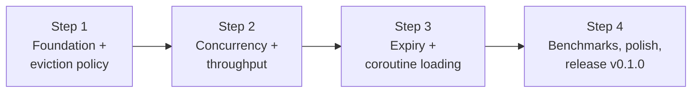

# Kaffeine: Project Plan (4 Steps)

Each step ends with **working, tested code** and a **measurable result**. Nothing is "done" until its tests pass in CI.

**Workflow per step:** branch `step-N-<name>` → small commits → PR → CI green → merge to `main`.

---

## Step 1: Foundation + eviction policy (simulator first)

**Goal:** a correct, single-lock cache (**v1**) with W-TinyLFU, checked against LRU, Caffeine and Bélády on real traces.

**Learn first:** `learn/02`, `learn/03`, `learn/04`, `learn/05`

### Tasks
- [x] Gradle wrapper, `settings.gradle.kts`, `libs.versions.toml` (pin latest stable versions), `core` + `bench` modules
- [x] `.github/workflows/ci.yml` running `./gradlew build`
- [x] Public API: `Cache`, `kaffeine {}` + validation, `CacheStats` (`Ticker` moved to Step 3, where expiry first needs it)
- [x] `Node`, `spread()`
- [x] `AccessOrderDeque` + tests
- [x] `FrequencySketch` (4-bit counters, aging) + tests
- [x] `BloomFilter` (doorkeeper) + tests
- [x] `WTinyLfuPolicy` + tests (scan resistance, promotion, demotion, `maximumSize = 1`)
- [x] `BoundedCache` **v1**: `ConcurrentHashMap` + **one `ReentrantLock` around every policy update** (no buffers yet): `getIfPresent`, `put`, `invalidate`, `invalidateAll`, `stats` (`cleanUp` moved to Step 2, it has nothing to do until there are buffers)
- [x] `CacheTest` (API semantics, size bound, validation)
- [x] Simulator: `Traces.kt` (LIRS, ARC), `SimPolicies.kt` (LRU, Kaffeine, Caffeine), `Belady.kt`, `Report.kt`, `Simulator.kt` CLI
- [x] `scripts/download-traces.sh`, `scripts/simulate-all.sh` + `SimulatorTest` (readers, LRU and Bélády worked out by hand, Bélády as the upper bound)
- [x] **Experiment:** doorkeeper on vs off on all traces → choose the default and record why in `bench/RESULTS.md` (result: off)

### Exit criteria
- [x] CI green
- [x] Hit-ratio tables for ≥ 4 traces × ≥ 3 sizes committed
- [x] Kaffeine is within ~1 pp of Caffeine on average, **or** the gap is explained (likely: no adaptive window)

### After Step 1 you can answer
- Why does LRU fail on scans, and how does W-TinyLFU fix it?
- How does a Count-Min Sketch work? Why the minimum? Why 4-bit counters? Why halve?
- What does the doorkeeper do, and did it help? (with your numbers)
- What is Bélády's algorithm, and why can't it be used in production?

---

## Step 2: Concurrency + throughput

**Goal:** make reads lock-free (**v2**: buffers + `tryLock` maintenance), prove it's still correct, and **measure** the speedup.

**Learn first:** `learn/07`, `learn/08`

### Tasks
- [x] JMH harness: `Zipf.kt`, `BenchCaches.kt` (Kaffeine, Caffeine, LinkedHashMap+lock, CHM), `GetPutBenchmark`
- [x] **Run JMH on v1** → numbers in `bench/RESULTS.md` (the baseline)
- [x] `ReadBuffer` (striped, lossy, grows on contention) + tests
- [x] Write buffer (`ConcurrentLinkedQueue` of small tasks, with back-pressure). Value updates go through the read buffer
- [x] Node lifecycle (`ALIVE`/`RETIRED`/`DEAD`) and the task rules (LLD §7.7)
- [x] `tryMaintenance()` with the re-check loop (no lost wakeup)
- [x] `cleanUp()` (force maintenance now)
- [x] `StressTest` (8 threads, random ops, invariants incl. policy size == map size)
- [x] `LincheckTest` (model checking + stress, plus a check that the policy matches the map)
- [x] **Run JMH on v2** → compare with v1 and Caffeine in `bench/RESULTS.md`
- [ ] If the gap is big: profile (JFR / async-profiler), try padding against false sharing, record what helped (moved to Step 4)
- [x] Re-run the simulator: hit ratio must not change by more than ~0.5 pp (+0.1 on average, 25 of 29 points within 0.5; the loop trace swings more, see `bench/RESULTS.md`)

### Exit criteria
- [x] CI green, including Lincheck and the stress tests
- [x] Documented: "v1 6.5M ops/s → v2 77.2M ops/s (8 threads, read_100)" and Kaffeine vs Caffeine

### After Step 2 you can answer
- Why is the read buffer allowed to drop events but the write buffer isn't?
- What race does the Node lifecycle solve? (R1/R2 in the LLD)
- What is a lost wakeup and how did you prevent it?
- How did you make sure your benchmark numbers aren't lying?

---

## Step 3: Expiry + coroutine loading

**Goal:** time-based expiry with a hierarchical timing wheel, and the `suspend get(key, loader)` with coalescing and the cancellation rules.

**Learn first:** `learn/01`, `learn/06`

### Tasks
- [x] `Ticker` + `FakeTicker` (test), relative time (`origin`), saturating `expiresAt`
- [x] `TimerWheel` + tests (tick, cascade, overflow, deschedule, big time jumps)
- [x] Expiry modes: `expireAfterWrite`, `expireAfterAccess`, `expireAfter {}`. Read-time check; `expireNode` with re-check (R4, R5)
- [x] `ExpiryTest`
- [x] `suspend get(key, loader)`: `inFlight` + `CompletableDeferred` + `cacheScope` (LLD §7.8). A finished load only fills a gap, so a concurrent `put` wins
- [x] `LoadingTest`: 1,000 callers → 1 load (and 16 real threads → 1 load); failure + retry; cancel one / cancel all; invalidate or put during load; `loadContext`
- [x] Add `get(key, loader)` to `LincheckTest`
- [x] Complete stats (load success/failure/time)
- [x] JMH: read benchmark with expiry on → record the cost of expiry
- [x] Kover: core coverage ≥ 85%, enforced in CI (97% now)

### Exit criteria
- [ ] CI green with coverage ≥ 85%
- [x] Every FR in the PRD is implemented and tested

### After Step 3 you can answer
- How does a hierarchical timing wheel give O(1) expiry? What is cascading?
- Why is the wheel not enough on its own (why also check on read)?
- What is a cache stampede, and how does your coalescing work, line by line?
- What happens when the first caller is cancelled? When the loader throws? When someone invalidates mid-load?
- How do Kotlin coroutines differ from Node.js async/await and Java's `CompletableFuture`?

---

## Step 4: Benchmarks, polish, release

**Goal:** publish honest results, a great README, and `v0.1.0` on JitPack.

### Tasks
- [ ] Full simulator run: all traces × sizes → final tables + charts
- [ ] Full JMH run: 3 workloads × 1/4/8 threads × {LinkedHashMap+lock, Kaffeine, Caffeine, CHM} → final tables + charts
- [ ] README: what and why, quickstart, design summary (link docs), results with honest analysis (where we lose and why), how to reproduce
- [ ] KDoc on every public API
- [ ] `maven-publish` on `core` + `jitpack.yml` (JDK 17); tag `v0.1.0`; check it works by depending on it from a scratch project
- [ ] Final resume bullet with **real numbers**

### Stretch (only if everything above is done)
- [ ] Profile the read path against Caffeine (JFR / async-profiler): background maintenance, padding, cheaper stripe choice
- [ ] Adaptive window (hill climbing), then re-run the simulator and compare
- [ ] Bounded write buffer with back-pressure
- [ ] Removal listener
- [ ] Measure memory per entry (JOL)

### Exit criteria
- [ ] All PRD success metrics checked ✓
- [ ] Anyone can reproduce every number with the commands in the README

### After Step 4 you can answer
- Show me your results. Where are you worse than Caffeine, and why?
- If you had 2 more weeks, what would you build next? (stretch list + reasons)
